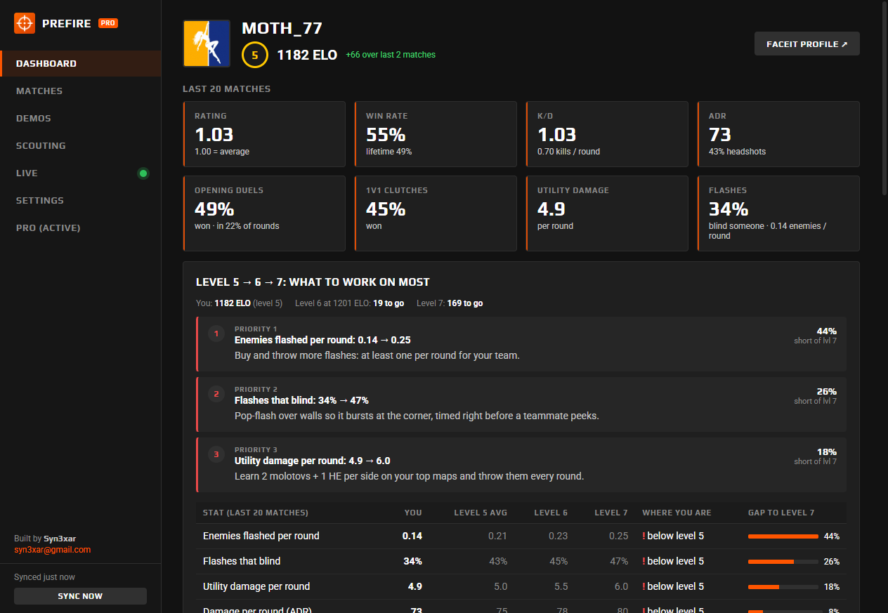
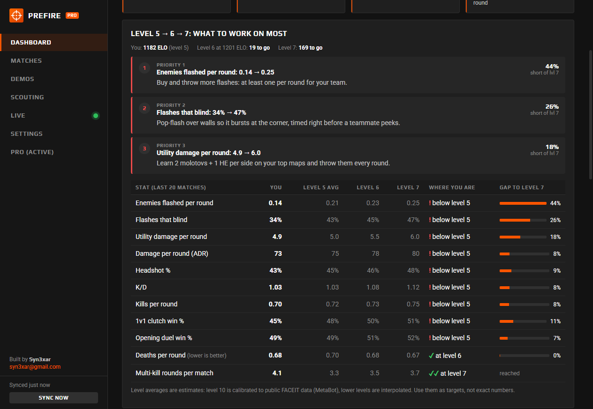
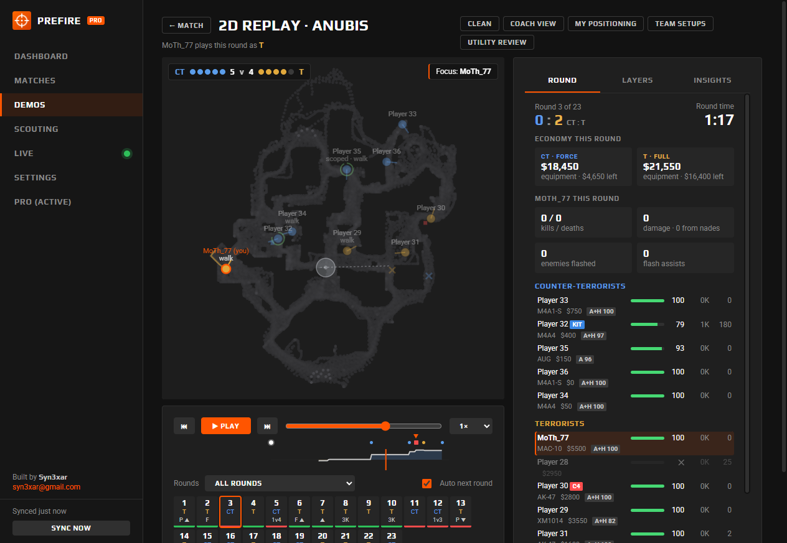
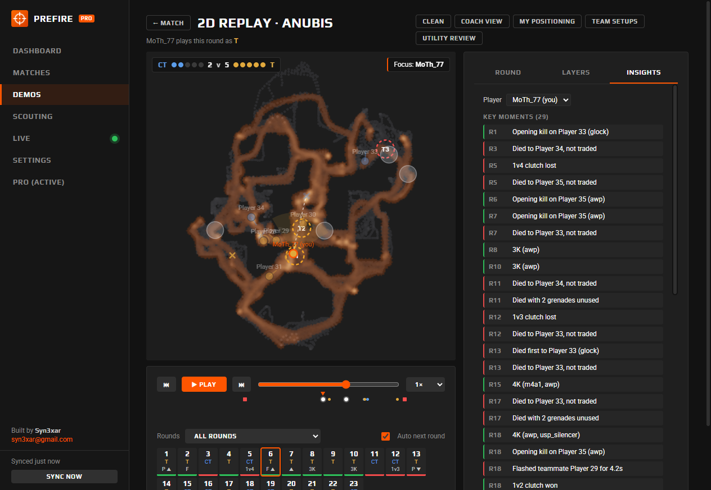
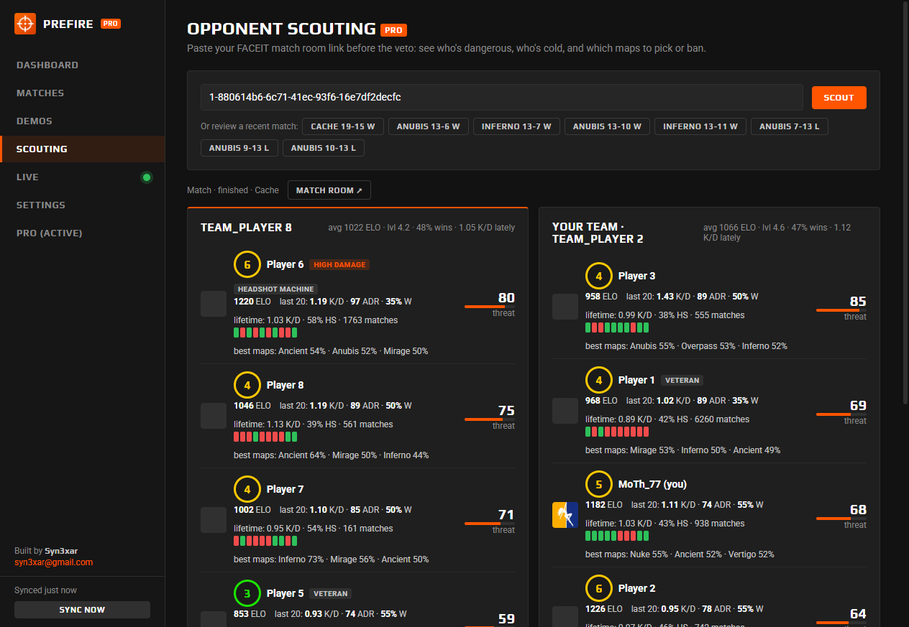
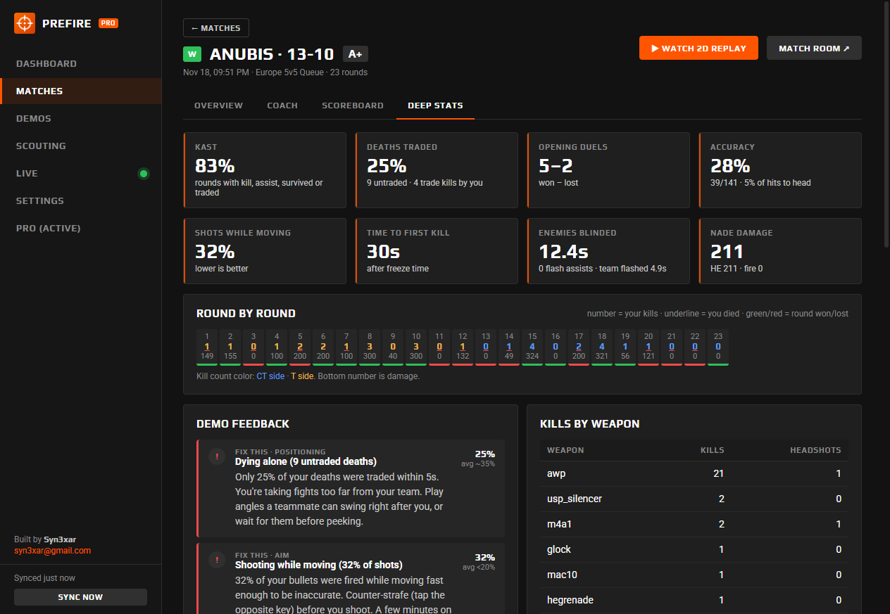
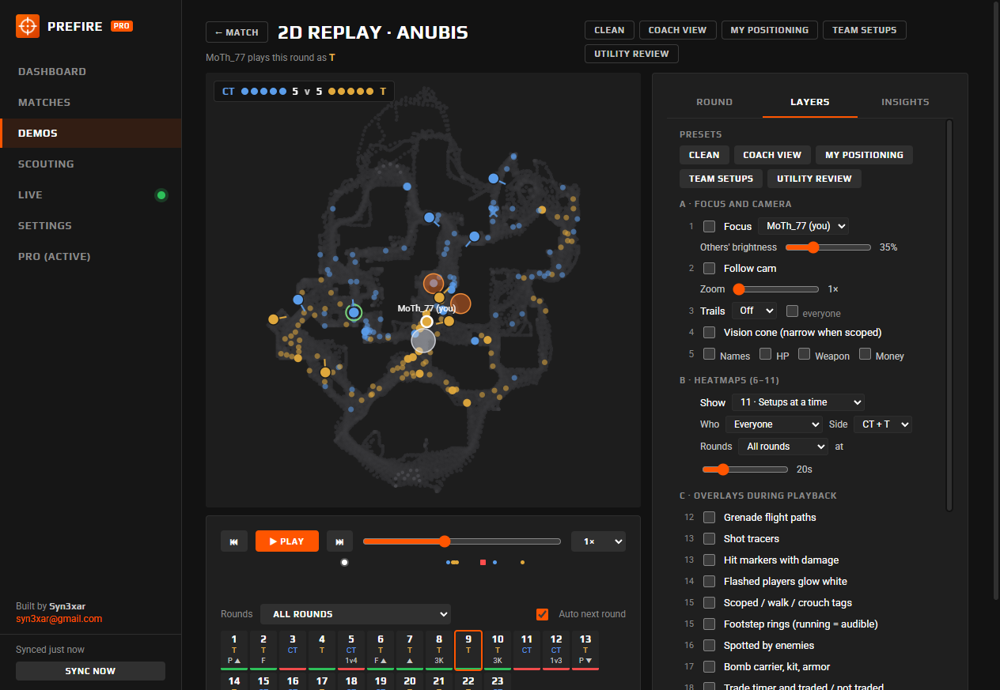

# Prefire

**CS2 stats, coaching, opponent scouting and 2D demo replays for FACEIT players.**
Windows desktop app · Built by [Syn3xar](https://github.com/Syn3xar) · Contact: [syn3xar@gmail.com](mailto:syn3xar@gmail.com)

### [⬇ Download the latest version](https://github.com/Syn3xar/prefire-releases/releases/latest)



## What it does

- **Automatic match sync:** every FACEIT CS2 match is pulled in with a notification showing the result and ELO change.
- **Coaching:** every match gets a rating, a grade and coaching notes (damage, opening duels, trades, utility, flashes, survival…).
- **What to work on to reach the next level:** your stats next to the average of your level and the levels above, ranked by priority.
- **Opponent scouting (Pro):** paste your match room link before the veto to see both teams' form, the biggest threats, their best maps and a pick/ban suggestion.
- **2D demo replay:** watch any match from above, with grenades, the bomb, kills and the kill feed. Pro adds 27 analysis layers: heatmaps, team setups, focus and follow cam, trails, trade timers, round economy, key moments and more.
- **Demo library:** download a demo on FACEIT and Prefire picks it up from your Downloads folder, then stores and analyzes it.
- **Live tracking:** uses CS2's official Game State Integration, the same feature HUD and overlay tools use.

## Compatible with FACEIT Anti-Cheat

Prefire never touches the game. It runs as its own app and doesn't inject anything, hook into CS2 or read the game's memory. Its data comes from FACEIT's public API, from demo files you download, and from CS2's built-in Game State Integration: a small config file in your CS2 folder that makes the game itself send round info to Prefire. Tested in FACEIT matches with the anti-cheat running.

| | |
|---|---|
|  |  |
|  |  |
|  |  |

More screenshots are in [`screenshots/`](screenshots).

## Free and Pro

| | Free | Pro |
|---|---|---|
| Match sync | Last 30 matches, notifications, ELO tracking | Full history (up to 500 matches) |
| Coach | Grade, summary, top 3 notes per match | Every note, including demo-based feedback |
| Level comparison | You vs the next level | Next level and the one after, all priorities |
| Opponent scouting | — | ✓ |
| Demos | Library, auto import, KAST / trades / accuracy | All deep stats |
| 2D replay | Full playback | All 27 analysis layers |
| Live | Score, K/A/D, rounds | Live tips |

**Pro is a one-time payment.** No subscription and no account. Pay with Bitcoin, USDT (BNB Smart Chain) or Solana from the **Get Pro** page in the app, email your transaction ID to syn3xar@gmail.com, and you'll get a license key that works offline.

## Install

1. Download `Prefire-Setup-x.y.z.exe` from the [latest release](https://github.com/Syn3xar/prefire-releases/releases/latest) and run it.
2. Windows may show "Windows protected your PC" because the installer isn't code-signed yet. Click **More info** → **Run anyway**.
3. In Prefire, open **Settings** and enter your FACEIT nickname and a free FACEIT API key. To get a key, go to [developers.faceit.com](https://developers.faceit.com), create an App, then add a **Server side** key.
4. Optional: on the **Live** page, click **Install CS2 config** and restart CS2 to track your games live.

To check your download, compare the installer's SHA-256 with the one in the release notes:

```powershell
Get-FileHash .\Prefire-Setup-0.1.0.exe -Algorithm SHA256
```

## Privacy

Everything stays on your PC (`%APPDATA%\Prefire`). Your FACEIT API key is stored encrypted with Windows DPAPI. Prefire talks only to FACEIT's API, and to CoinGecko for live crypto prices on the Pro page.

## Support

Bugs, questions or ideas: open an [issue](https://github.com/Syn3xar/prefire-releases/issues) or email **syn3xar@gmail.com**.

---

Prefire is an independent app. It is not affiliated with or endorsed by FACEIT or Valve. Counter-Strike and CS2 are trademarks of Valve Corporation; FACEIT is a trademark of its owner.
Copyright © 2026 Syn3xar. All rights reserved. This repository hosts release downloads only; the source code is private.
